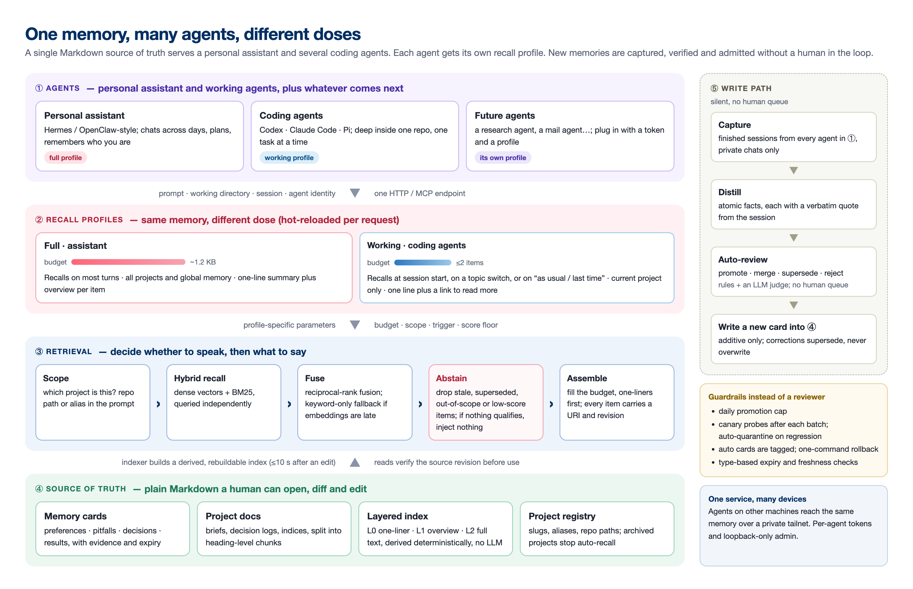
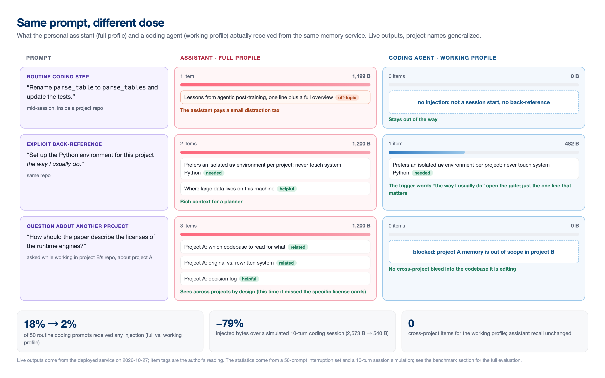
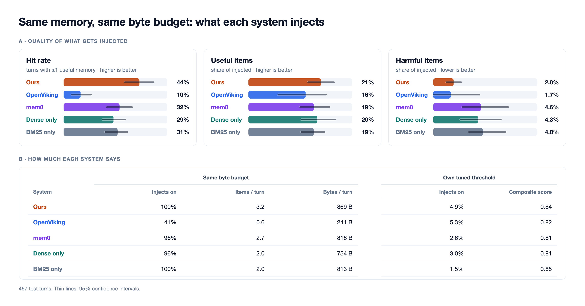

# Titrate

**一份 Markdown 记忆，多个 agent，每个拿到合适的剂量。**

Titrate 是一个开放的记忆层设计，供你所有的 AI agent 共用：跨天聊天的个人助手、
在单个仓库里干活的 coding agent，以及你之后接入的任何 agent。它以**搭建说明**
（build spec）的形式发布。你把说明交给自己的 coding agent，由它在你的机器上，
按你的文件夹、模型服务和 agent 搭出这套系统。

## 它提供什么

- **一份人能读的权威记忆。** 记忆是普通的 Markdown 卡片和项目笔记。检索索引由它们
  派生，随时可以丢掉重建。所有内容都可以直接打开、对比、修改。
- **不同 agent 拿不同剂量。** 个人助手在大多数轮次里广泛召回。coding agent 最多拿到
  一两行，只来自当前项目，并且只在会话开始、切换项目或主动提起（“按我的习惯”）时注入。
  任何 agent 都可以主动检索记忆。
- **沉默也是一种回答。** 每次注入都要过分数门槛，并装进固定的字节预算。没有合格内容
  时，就什么都不注入。
- **记忆自己维护自己。** 结束的会话会被提炼成候选事实，每条都附上对话原文引用。
  自动评审决定晋升、合并、取代或拒绝。纠正会生成一张新卡取代旧卡，旧卡保留在磁盘上。
  每日上限、canary 探针和一键回滚取代了人工审核队列。
- **能用你自己的真实使用来评测。** `eval/` 用你过去的真实对话轮次，对照每周的记忆
  快照重放，再由盲评的 LLM 评委结合后续对话判断：各系统注入的内容，哪些有用，哪些有害。

## 怎么用

1. **你和你的 coding agent 按 [`specs/01-memory-service.md`](specs/01-memory-service.md) 搭建服务。**
   agent 会先问你：笔记放在哪、哪些 agent 要读、用哪家 embedding 服务、状态存在哪。
   然后它搭建索引器、混合检索、召回画像，以及一个 REST/MCP 入口，再给每个 agent 写一个
   薄适配器。
2. **再按 [`specs/02-write-path.md`](specs/02-write-path.md) 搭写入链路。**
   包括会话采集、提炼、自动评审和各项保护措施。
3. **可选：用 [`eval/`](eval/) 评测。**
   从你自己的会话里抽取探针，把你的服务和 BM25、向量检索、OpenViking、mem0 对比，
   每个系统都按它原生的方式使用。见 [`eval/METHOD.md`](eval/METHOD.md)。

`examples/` 里有一个虚构的小型记忆文件夹、一份画像配置，以及注入内容的样子。

## 快速开始

**把这段交给你的 coding agent**（Claude Code、Codex 等）：

> Clone https://github.com/jxtse/titrate。先读 `README.md`，再读 `specs/01-memory-service.md`。
> 按说明先就我的环境问我问题，然后为我的 agent 搭建记忆服务。通过说明里的验收标准后，
> 再按 `specs/02-write-path.md` 搭写入链路。

之后想评测：

> 读 `eval/METHOD.md` 和 `eval/README.md`，为我的 agent 会话日志写一个探针抽取器，
> 用我的记忆文件夹生成每周快照，运行评测工具，把我的记忆服务和各个基线对比。

如果想先自己读，从两份 spec 开始。它们篇幅不长，只写设计决策，实现细节留给你的 agent。

## 评测结果

在一个人约五周的真实个人助手和 coding agent 会话上（测试集 467 个已评判轮次），
所有系统使用同一份记忆和同样的字节预算：

参考实现让 44% 的轮次拿到了有用记忆，mem0、向量检索和 BM25 是 29–32%；有害注入约为
它们的一半。各系统的有用比例接近。细节、局限（只有一位用户、LLM 评委）以及没有奏效的
做法见 [`eval/METHOD.md`](eval/METHOD.md) 和[博客文章](https://jxtse.github.io)。

## 目录

| 路径 | 内容 |
|---|---|
| `specs/01-memory-service.md` | 搭建说明：索引、检索、召回画像、服务 |
| `specs/02-write-path.md` | 搭建说明：采集、提炼、自动评审、保护措施 |
| `eval/` | 评测方法和可运行的评测工具（Python，`uv`） |
| `examples/` | 虚构的记忆文件夹、画像配置、注入示例 |
| `docs/figures/` | 上面用到的图 |

## 状态

这些说明描述的是作者每天在用的系统，服务一个个人助手和两个 coding agent。参考实现本身
不发布：它和一台机器绑得太紧，一份说明更容易适配到你的环境。欢迎提 issue，或分享你自己
搭建的经验。

[English](README.md) · MIT License
